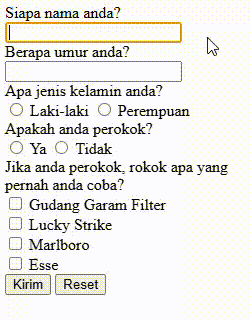
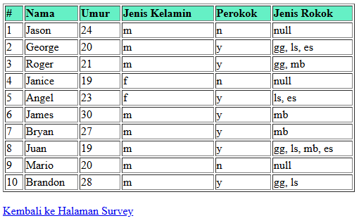
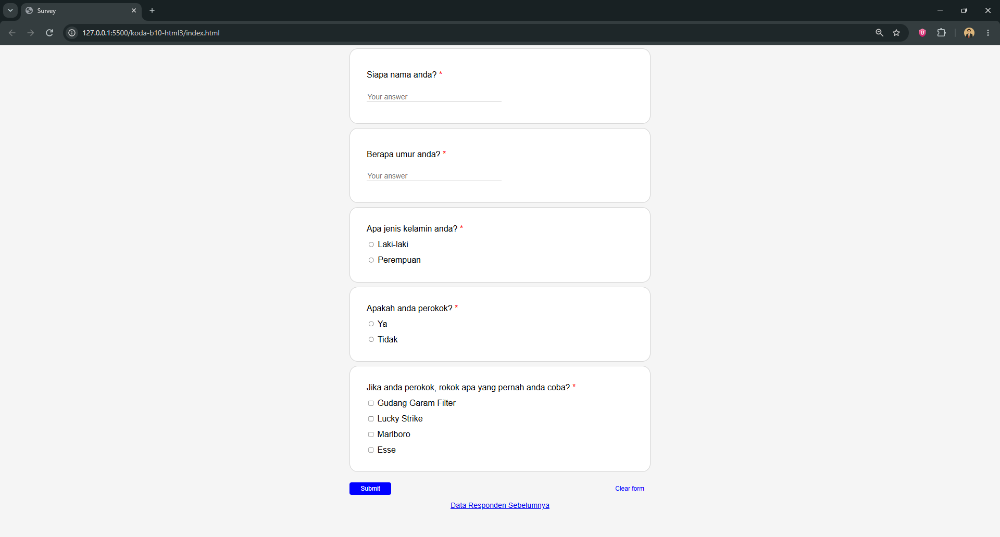
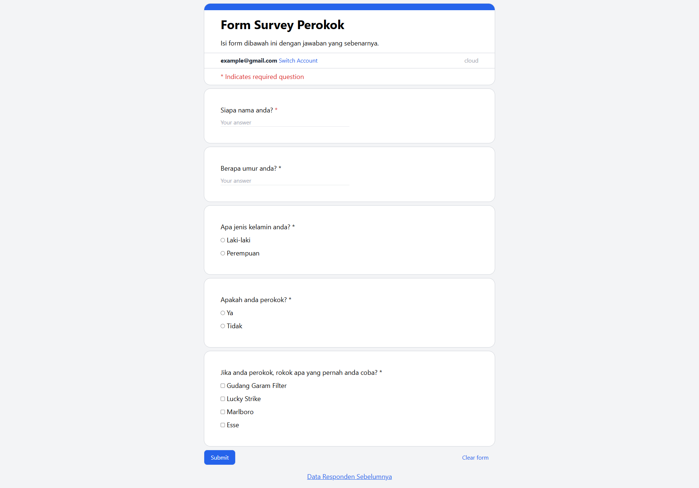

# Materi: HTML - form tags

Membuat survey untuk perokok menggunakan form tags, input dan button

**Survey Page (Screen Record)**

**Data Page (Screenshot)**

## CSS Styling

Membuat style agar tampilan menyerupai style Google Form

## UPDATE: Refactor Using Tailwind

Membuat ulang style yang sama dengan menggunakan Tailwind

